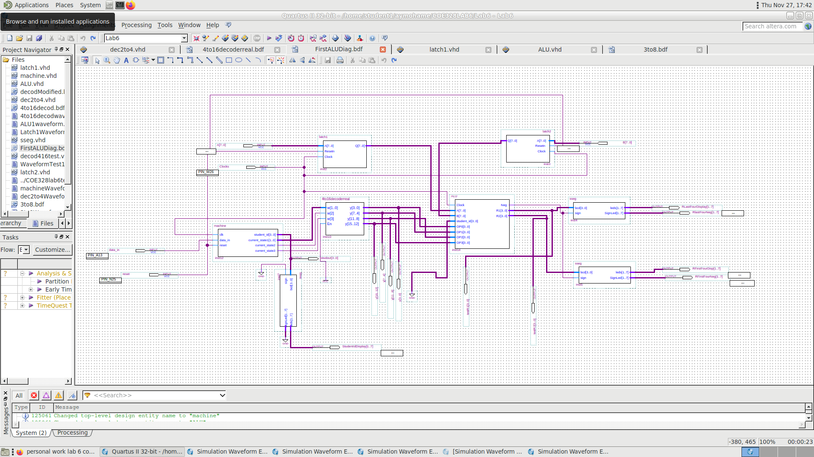
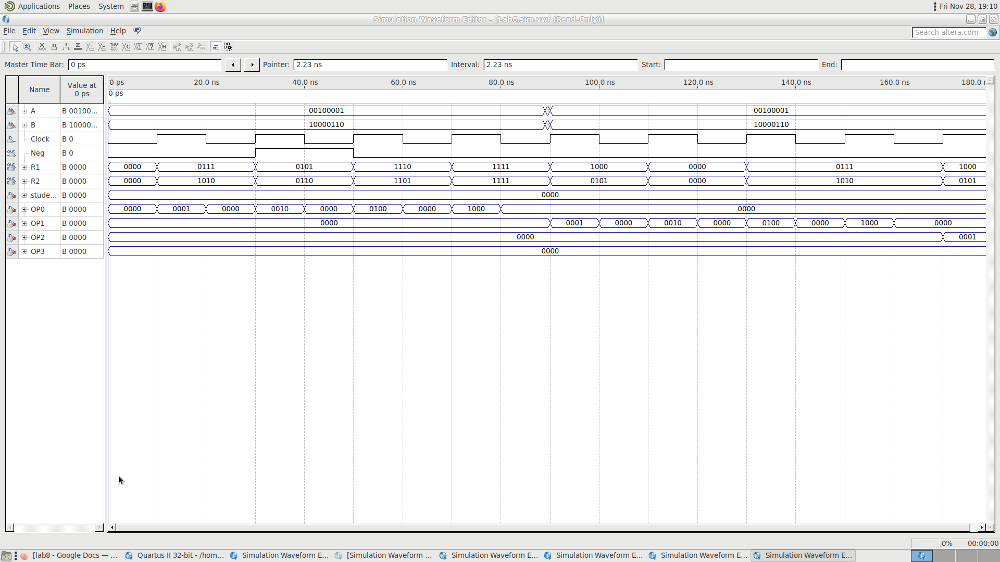
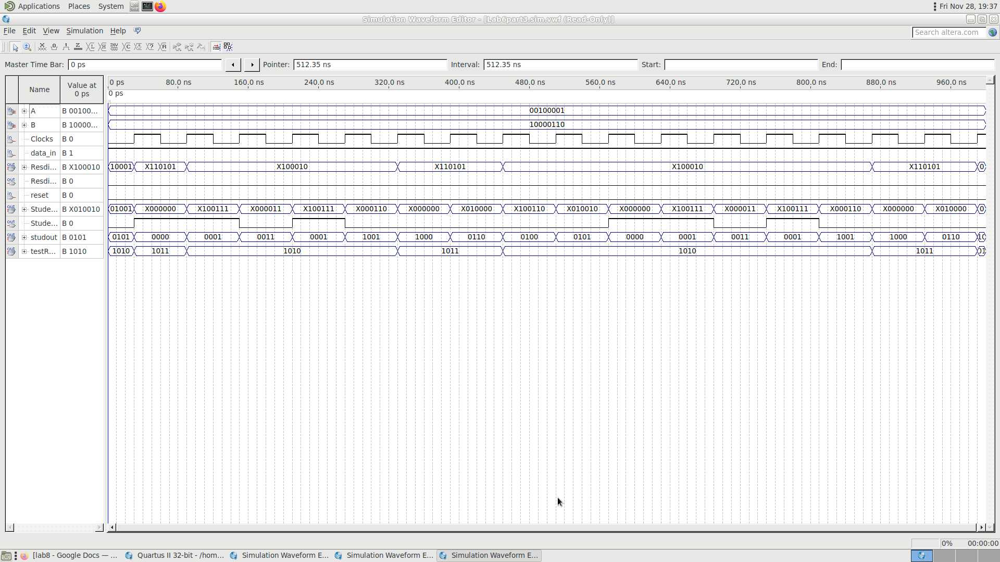

# 8-Bit FPGA Processor & ALU Design

A modular 8-bit datapath built with **VHDL and Quartus block diagrams** for COE328 Lab 6. The project combines operand registers, a finite-state machine (FSM), operation decoding, three ALU variants, and seven-segment display logic.

The repository contains the ALU and control/display circuitry used in the lab, along with waveform stimulus files and captured simulation results.

## Design Overview

The integrated block diagrams connect these components:

- **Operand registers:** Capture the 8-bit inputs `A` and `B` on a rising clock edge.
- **Finite-state machine:** Cycles through nine states when `data_in` is high, producing a state code and a student-ID digit.
- **Decoder circuitry:** Converts the operation selection into one-hot control signals.
- **ALU:** Performs the selected arithmetic, logical, or bit-manipulation operation.
- **Seven-segment decoders:** Display result nibbles, the subtraction sign, and the FSM digit. Part 3 includes a dedicated yes/no display decoder.

The register modules are named `latch1` and `latch2`, but their implementation uses rising-edge-triggered storage with an asynchronous, active-high reset.

## Project Structure

| Directory | Contents |
| --- | --- |
| [COE328LAB6](COE328LAB6) | Part 1: arithmetic and Boolean ALU, registers, FSM, decoders, and integrated diagrams |
| [COE328LAB6PART2](COE328LAB6PART2) | Part 2: custom bit-manipulation ALU and integrated design |
| [COE328LAB6PART3REAL](COE328LAB6PART3REAL) | Part 3: nibble comparison and yes/no display logic |
| [LAB6SCREENSHOTS](LAB6SCREENSHOTS) | Block diagrams and captured waveform results |

Each project folder includes VHDL sources (`.vhd`), block diagrams (`.bdf`), waveform stimulus files (`.vwf`), and Quartus project settings (`.qpf` and `.qsf`). Symbol files (`.bsf`) are included where present.

## ALU Operations

### Part 1 — Arithmetic and Logic

[ALU.vhd](COE328LAB6/ALU.vhd) combines four control nibbles into a 16-bit one-hot selector:

```vhdl
OP <= OP3 & OP2 & OP1 & OP0;
```

| Active OP bit | Operation | Result |
| --- | --- | --- |
| 0 | Addition | `A + B` |
| 1 | Subtraction | `abs(A - B)`; `Neg = 1` when `A < B` |
| 2 | Inversion | `NOT A` |
| 3 | NAND | `NOT (A AND B)` |
| 4 | NOR | `NOT (A OR B)` |
| 5 | AND | `A AND B` |
| 6 | OR | `A OR B` |
| 7 | XOR | `A XOR B` |
| 8 | XNOR | `A XNOR B` |

Results update on the rising clock edge. `R1` carries the lower four result bits and `R2` carries the upper four. Addition uses an 8-bit result without a carry output; subtraction displays magnitude and sign separately.

### Part 2 — Custom Operations

[ALU2.vhd](COE328LAB6PART2/ALU2.vhd) uses the same one-hot control format.

| Active OP bit | Operation |
| --- | --- |
| 0 | Rotate `A` right by four bits (swap nibbles) |
| 1 | XOR `A` and `B` |
| 2 | Reverse the bit order of `B` |
| 3 | Compute `A + B - 2` using 8-bit unsigned arithmetic |
| 4 | Rotate `B` left by two bits |
| 5 | Invert bits 0, 2, 4, and 6 of `B` |
| 6 | Concatenate `B(3 downto 0)` with `A(3 downto 0)` |
| 7 | Shift `B` right by two bits, filling with zeros |
| 8 | Invert the lower nibble of `A`, preserving its upper nibble |

Both Part 1 and Part 2 retain the previous result for unrecognized OP patterns.

### Part 3 — Nibble Comparison

[ALU3.vhd](COE328LAB6PART3REAL/ALU3.vhd) compares each four-bit nibble of `B` against the current `student_id` digit:

- If either nibble is greater, output `1010`, displayed as **y**.
- Otherwise, output `1011`, displayed as **n**.

The comparison updates on the rising clock edge. In this implementation, `A` and the OP inputs do not affect the result.

## Open in Quartus

The saved projects specify **Quartus II 13.0 SP1** and the **Cyclone II EP2C35F672C6** device. Use a Quartus installation with support for that device.

1. Clone or download this repository, keeping the folder structure intact.
2. Open the appropriate project:

   | Part | Project file | Saved top-level entity |
   | --- | --- | --- |
   | 1 | `COE328LAB6/Lab6.qpf` | `FirstALUDiag` |
   | 2 | `COE328LAB6PART2/Lab6Part2.qpf` | `SecondALUDiag` |
   | 3 | `COE328LAB6PART3REAL/Lab6part3.qpf` | `ALU3` |

3. Review the project file list and waveform paths. Some saved settings reference the original workstation or sibling folders that are absent from this repository; remove stale references or select the included local files.
4. Choose the intended top-level design. Part 3 is saved with the standalone `ALU3` entity; select `ThirdALUDiag` when working with its integrated block diagram.
5. Run analysis and compilation. For waveform simulation, open an included `.vwf` file and configure the simulation tool for your installation.
6. Before programming hardware, check the device selection and pin assignments against your board.

Generated build databases, programming outputs, and temporary backups are excluded. Compilation regenerates the required build outputs.

## Simulation Examples

The repository includes stimulus waveforms for individual components and integrated designs. Existing captures can be viewed in [LAB6SCREENSHOTS](LAB6SCREENSHOTS).

### Part 1 — Integrated Design



### Part 1 — ALU Waveform



### Part 3 — Comparison Waveform


